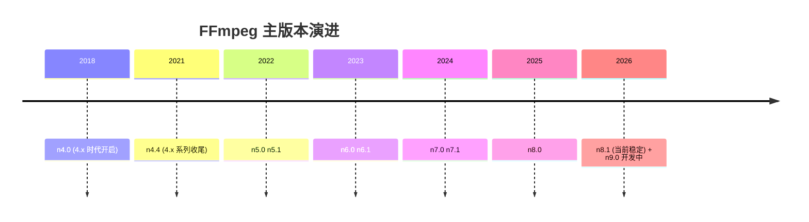
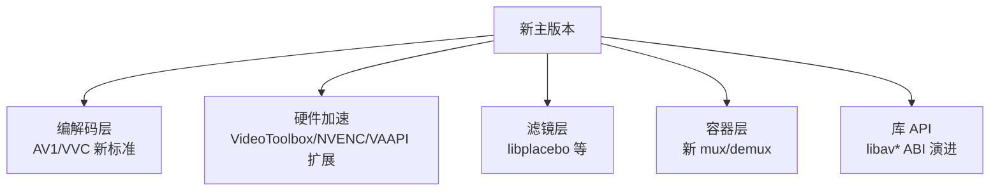

# FFmpeg 版本迭代史：为什么从 4.x 一路到了 9.0

> [!NOTE] 版本快照
> 本仓库 `release/9.0` · `n8.2-dev-2193-g3c287af3af` · 文档日期 `2026-08-02`。本页版本数据来自本仓库 `git tag` 实际标注的发布日期（最可靠来源），代号补充自 FFmpeg 官方发布页。

很多用户有同样的困惑："我还在用 4.0/4.4，怎么几年没见，FFmpeg 直接到 9.0 了？"

**核心答案：不是 FFmpeg 迭代变快了 5 倍，而是 FFmpeg 在 2022 年改变了版本编号策略。**



这张图回答一个问题：**FFmpeg 主版本号在时间轴上的分布**。可以看到 2022 年起每年稳定升一个主版本号。

## 一、版本号本身：到底跳了几次

从本仓库 `git tag` 提取的真实发布节奏：

| 版本 | 发布日期 | 上一版间隔 | 说明 |
| --- | --- | --- | --- |
| n4.0 | 2018-04-20 | — | 4.x 时代开始 |
| n4.1 | 2018-11-05 | ~7 个月 | |
| n4.2 | 2019-08-05 | ~9 个月 | |
| n4.3 | 2020-06-15 | ~10 个月 | |
| n4.4 | 2021-04-08 | ~10 个月 | 4.x 系列最后 |
| n5.0 | 2022-01-14 | ~9 个月 | **新编号策略开始** |
| n5.1 | 2022-07-22 | ~6 个月 | |
| n6.0 | 2023-02-26 | ~7 个月 | |
| n6.1 | 2023-11-10 | ~9 个月 | |
| n7.0 | 2024-04-05 | ~5 个月 | |
| n7.1 | 2024-09-29 | ~6 个月 | |
| n8.0 | 2025-08-22 | ~11 个月 | |
| n8.1 | 2026-03-16 | ~7 个月 | 当前最新稳定 |
| n9.0 | 开发中 | — | 本仓库当前分支 |

> [!IMPORTANT]
> **关键洞察：发布频率其实一直很稳定（每 6~11 个月一个 release），变的是编号策略**。4.x 时代"主版本号"停留在 4 持续了 3 年（靠 4.0→4.1→...→4.4 的次版本号区分）；2022 年起"每个 release 都升主版本号"（5.0、6.0、7.0...）。所以数字涨得快，不代表开发速度突然变快。

## 二、为什么版本编号策略变了

这不是 FFmpeg 独有的现象，是**软件工程里常见的"版本号语义"演进**，有实际工程原因：

### 1. 语义化版本（SemVer）意识的普及

早期 C/C++ 项目沿用旧的"主.次.修订"习惯：主版本号只在"不兼容的大变化"时才升。FFmpeg 这类**库项目**（libavcodec/libavformat 等）有严格的 ABI 兼容保证，主版本号曾经升得很谨慎。

后来社区逐渐接受：**对于频繁发布、活跃迭代的项目，每个 feature release 升主版本号更清晰**。这避免"4.4 到底比 4.0 新多少"这种含糊。

### 2. 新编解码器/容器标准的爆发

2020 年代是音视频格式密集换代期，每个大版本都要容纳大量新标准：

| 版本 | 主要新增 |
| --- | --- |
| 4.x | AV1 解码/编码完善、libvmaf 集成 |
| 5.0 | 正式支持 AV1 编码、大量新滤镜 |
| 6.0 | VVC（H.266）解码起步、libplacebo 滤镜 |
| 7.0 | 更完整的 VVC、硬件加速进一步扩展 |
| 8.0 | 继续扩展新格式与硬件后端 |

新标准一多，每个 release 的功能增量都"够格"升一个主版本号。

### 3. 维护与发布节奏现代化

FFmpeg 逐渐采用更规范的"时间驱动发布"（time-based release）：**固定周期切分支、发版本**，而不是"攒够功能再发"。这让版本号递增变得规律，也同步支持下游（发行版、OBS 等）的打包节奏。

> [!TIP]
> **对使用者意味着什么？** 版本号递增快 ≠ 你必须每年升级。稳定项目（如 OBS 内置、发行版打包）通常锁定一个大版本长期用，靠补丁版本（如 8.0.3、7.1.5）修 bug，不追求追新。看版本号变化，重点是理解"每个新主版本的增量"，而不是焦虑"是不是落后了"。

## 三、版本号里到底在变什么

版本号只是编号，真正重要的是背后的技术演进。按层看：



这张图回答一个问题：**每个主版本号背后变的是什么**。FFmpeg 的版本演进是多层并进的。

### 关键演进线

- **AV1**：从 4.x 时期的起步，到 6.0/7.0 的成熟编码解码。
- **VVC（H.266）**：6.0 开始有解码，后续版本持续完善——这是当前音视频领域最热的编解码演进。
- **硬件加速**：macOS 的 VideoToolbox、N 卡的 NVENC、Intel 的 VAAPI/QSV 持续扩展，每个大版本都有后端优化。
- **libplacebo 滤镜**：把专业级渲染（色彩管理、HDR、缩放）引入 FFmpeg 滤镜链。
- **库 API**：libavutil 61 / libavcodec 63 / libavformat 63（当前 9.0-dev 的库版本），是下游开发者的兼容性边界。

> [!NOTE]
> **库版本 vs 发布版本是两套编号**。FFmpeg 发布版用 `n8.1` 这种 tag，但它的库（libavcodec 等）有自己的 ABI 版本号（如 `63.1.100`）。库版本号升降才是"API 是否兼容"的真相，发布版号只是给人看的里程碑。

## 四、版本对照速查表

| 你记得的版本 | 对应年代 | 当时在演进什么 | 现在的对应关系 |
| --- | --- | --- | --- |
| 4.0 / 4.2 | 2018-2019 | AV1 起步、libvmaf | 已被 5.x 取代 |
| 4.4 | 2021 | 4.x 收官、AV1 成熟 | 被 5.0 取代 |
| 5.1 | 2022 | AV1 编码正式化 | 被 6.x 取代 |
| 6.1 | 2023 | VVC 起步、libplacebo | 被 7.x 取代 |
| 7.1 | 2024 | VVC 完善、硬件加速扩展 | 被 8.x 取代 |
| 8.1 | 2026 | 当前稳定主流 | 当前推荐 |
| 9.0 | 开发中 | 下一大版本 | 可尝鲜 |

## 五、给使用者的建议

> [!WARNING]
> **别因为"版本号到 9 了"就觉得 4.x 完全不能用了**。4.x 的核心功能（H.264/H.265 编解码、主流容器）至今可用且稳定。区别在于：新格式（VVC）、新硬件加速、新滤镜只在新的主版本里有。

- **要新标准/新硬件**（VVC、最新显卡加速）→ 用最新主版本（8.x/9.0）。
- **求稳定长期用**（服务器、生产打包）→ 锁一个主版本 + 补丁版本（如 7.1.x、8.0.x），只更新补丁。
- **做库开发**（调 libav* API）→ 关注**库 ABI 版本号**，不是发布版号。
- **从 4.x 升级**：主要变化在新增能力，基础 CLI 用法（`-i`/`-c:v`/`-c:a`）基本不变，可直接迁移；个别 deprecated 选项需查新文档。

## 六、版本史源数据

本页发布数据直接来自本仓库 git tag：

```text
n4.0 2018-04-20 · n4.1 2018-11-05 · n4.2 2019-08-05 · n4.3 2020-06-15 · n4.4 2021-04-08
n5.0 2022-01-14 · n5.1 2022-07-22
n6.0 2023-02-26 · n6.1 2023-11-10
n7.0 2024-04-05 · n7.1 2024-09-29
n8.0 2025-08-22 · n8.1 2026-03-16
```

验证命令：

```bash
cd /path/to/FFmpeg
git tag -l 'n*' --sort=creatordate   # 列出所有发布 tag 及时间
git log -1 --format=%ci n8.1         # 单个版本的确切日期
```
