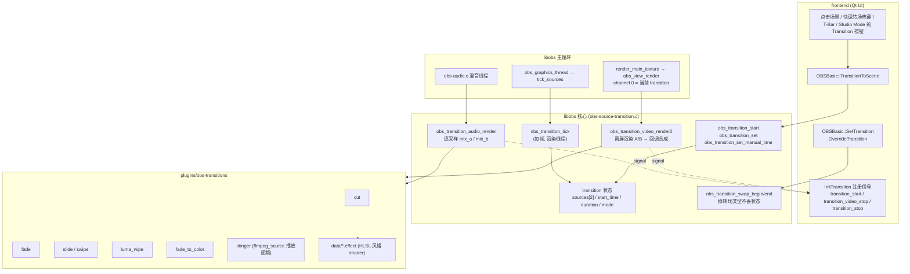
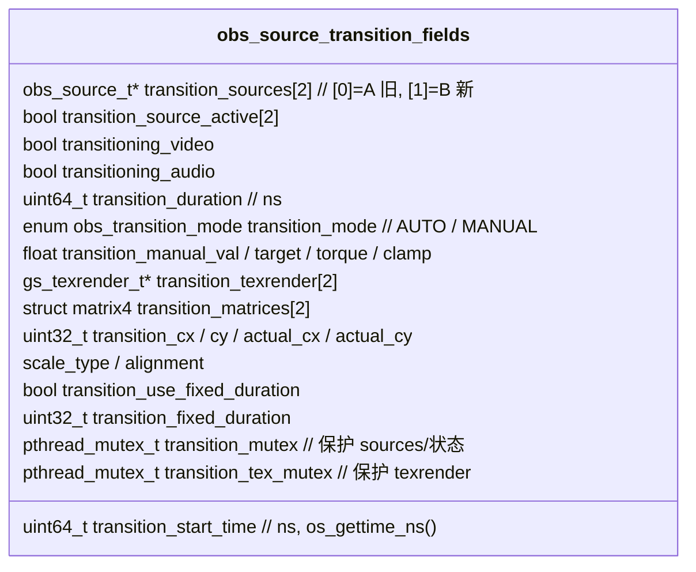
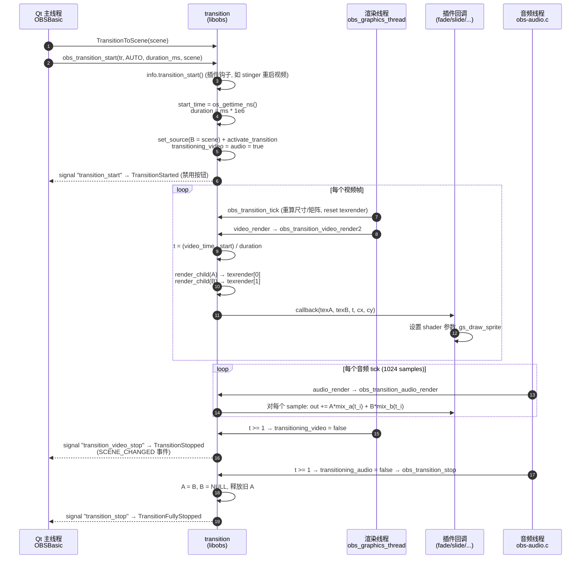
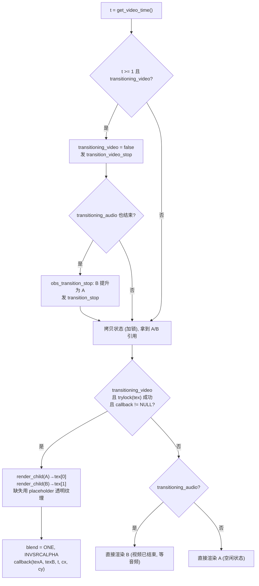
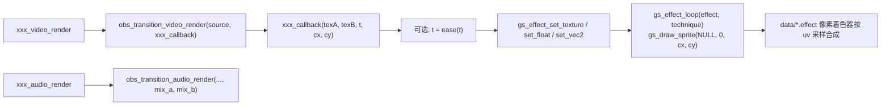
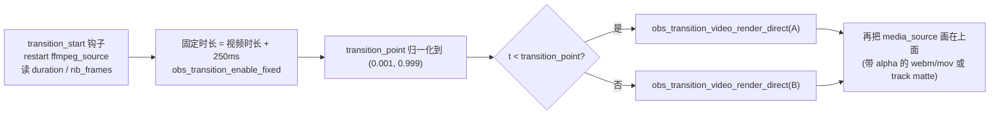
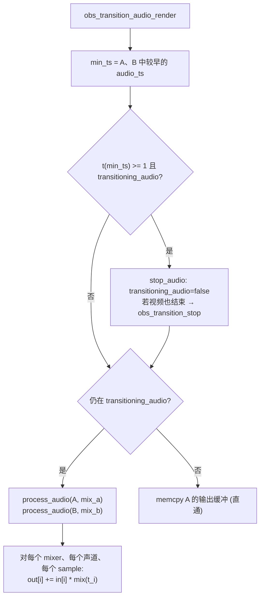
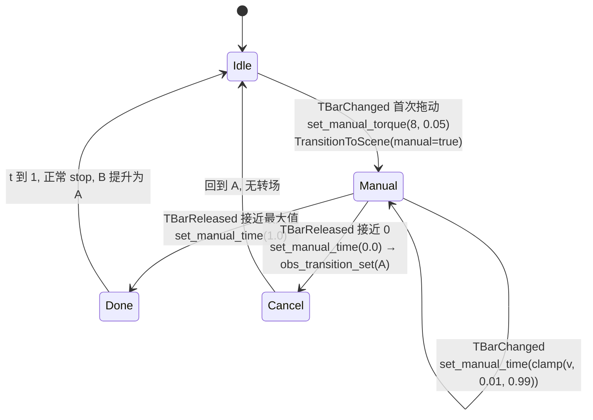

# OBS 场景切换动画（Transition）实现原理

定位：专题实现手册。回答“在 OBS 里点一下另一个场景，画面为什么能淡入、滑动、擦除、播放 Stinger 视频，而不是硬切”，并把这条链路从 Qt 前端一路追到 libobs 渲染循环和 GPU shader。

源码快照：

- 项目：`obs-studio`
- Git describe：`32.2.1`
- Commit：`0052d024fd6a5ff1aa04c76cbdffd3085a5dfacc`
- 文档日期：2026-10-13

阅读标记：

- `> [!IMPORTANT]`：核心合同、不变量，改代码时不能破坏。
- `> [!WARNING]`：容易踩坑的边界行为。
- `> [!TIP]`：调试、扩展建议。
- `> [!NOTE]`：背景解释。

---

## 1. 一句话结论

> [!IMPORTANT]
> OBS 的转场**本身就是一个 source**（`OBS_SOURCE_TYPE_TRANSITION`），常驻在输出通道 0 上。它内部持有两个子源 A（旧场景）和 B（新场景）。每一帧：
>
> 1. 根据 `video_time` 算出进度 `t ∈ [0,1]`；
> 2. 把 A、B 分别离屏渲染到两张纹理 `transition_texrender[0/1]`；
> 3. 把 `(texA, texB, t)` 交给具体转场插件的回调，由一个 shader 把两张纹理按 `t` 合成到当前渲染目标。
>
> 音频走同样的思路：对每个**采样点**算 `t`，用插件提供的 `mix_a(t)` / `mix_b(t)` 作为增益把两路音频混合。
>
> 切换场景 = 调用 `obs_transition_start(transition, mode, duration, newScene)` 把新场景塞进 B 槽并记录开始时间；动画结束后 B 被“提升”为 A。

所以“动画”不是 UI 层动画，而是 libobs 渲染线程里**逐帧重新合成**出来的画面，录制、推流、预览看到的都是同一份合成结果。

---

## 2. 架构地图

这张图回答：转场涉及哪几层，谁调用谁。



源码入口：

| 层 | 文件 | 关键符号 |
| --- | --- | --- |
| 前端 | `frontend/widgets/OBSBasic_Transitions.cpp:287` | `OBSBasic::TransitionToScene` |
| 前端 | `frontend/widgets/OBSBasic_Transitions.cpp:132` | `OBSBasic::InitTransition`（信号订阅） |
| 前端 | `frontend/widgets/OBSBasic_Transitions.cpp:413` | `OBSBasic::SetTransition` |
| 核心 | `libobs/obs-source-transition.c:327` | `obs_transition_start` |
| 核心 | `libobs/obs-source-transition.c:673` | `obs_transition_video_render2` |
| 核心 | `libobs/obs-source-transition.c:933` | `obs_transition_audio_render` |
| 主循环 | `libobs/obs-source.c:1364` | `obs_source_video_tick` → `obs_transition_tick` |
| 主循环 | `libobs/obs-video.c:202` | `render_main_texture` → `obs_view_render` |
| 插件注册 | `plugins/obs-transitions/obs-transitions.c:18` | `obs_module_load` 注册 7 种转场 |

> [!NOTE]
> 输出通道 0 上放的不是“当前场景”，而是“当前转场”。场景只是转场的子源。`obs_view_render`（`libobs/obs-view.c:118`）遍历各通道调用 `obs_source_video_render`，对通道 0 来说就进入了转场插件的 `video_render`。

---

## 3. 数据合同：转场的内部状态

这些字段都挂在 `struct obs_source` 上（`libobs/obs-internal.h:963-986`），只有 `type == OBS_SOURCE_TYPE_TRANSITION` 的 source 使用。



| 字段 | 含义 | 谁写 | 谁读 |
| --- | --- | --- | --- |
| `transition_sources[0]` | A：当前正在显示 / 即将离开的场景 | `obs_transition_set`、`obs_transition_stop`（B→A 提升） | 渲染、音频 |
| `transition_sources[1]` | B：目标场景；`NULL` 表示转到“空”（淡出到黑） | `obs_transition_start` → `set_source` | 渲染、音频 |
| `transitioning_video/audio` | 视频、音频是否仍在过渡。**两者独立结束** | `activate_transition` 置 true；渲染/音频路径各自置 false | `transition_active()` |
| `transition_start_time` + `duration` | 自动模式下计算进度 | `obs_transition_start` | `calc_time` |
| `transition_manual_*` | 手动模式（T-Bar）进度及平滑 | `obs_transition_set_manual_time/torque` | `obs_transition_tick` |
| `transition_texrender[2]` | A、B 的离屏渲染目标 | `render_child` | 插件回调拿到的 `a`、`b` 纹理 |
| `transition_matrices[2]` | 子源尺寸与转场尺寸不同时的缩放/对齐矩阵 | `recalculate_transition_matrix` | `render_child` |

> [!IMPORTANT]
> 不变量：
> - 非转场期间只有 A 有效，`transition_source_active[0] == true`，B 为 `NULL`。
> - 转场期间 A、B 都是 transition 的 **active child**（`obs_source_add_active_child`），这保证两个场景里的媒体源、采集源在过渡期间都处于激活状态、都在出帧。
> - 视频和音频都结束后才调用 `obs_transition_stop` 把 B 提升为 A，并释放旧 A。

---

## 4. 正常流程：一次自动转场

### 4.1 时序

这张图回答：从点击场景到动画结束，哪些线程做了什么。



### 4.2 进度 `t` 怎么来

`calc_time`（`libobs/obs-source-transition.c:446`）：

```c
if (mode == OBS_TRANSITION_MODE_MANUAL)
    return transition_manual_val;          // T-Bar
if (ts <= start_time)       return 0.0f;
if (ts - start_time >= duration || duration == 0) return 1.0f;
return (ts - start_time) / duration;       // 线性 0→1
```

- 视频用 `obs->video.video_time`（当前要输出那一帧的时间戳），见 `get_video_time`。
- 音频用 `child->audio_ts + sample_index / sample_rate`，见 `get_sample_time`（`:855`），**精确到每个采样点**。

> [!NOTE]
> 核心给出的 `t` 永远是线性的。“缓动”（ease-in-out）是插件自己在回调里对 `t` 再做一次映射，例如 slide/swipe 用 `cubic_ease_in_out`（`plugins/obs-transitions/easings.h:3`）。

### 4.3 视频渲染核心：`obs_transition_video_render2`

`libobs/obs-source-transition.c:673`，逻辑可以压缩成下面这张决策图：



关键细节：

1. **离屏渲染**：`render_child`（`:614`）对每个子源 `gs_texrender_begin_with_color_space` → `gs_ortho` → 乘上 `transition_matrices[idx]` → `obs_source_video_render(child)`。场景的整棵 scene item 树会被完整画进这张纹理。
2. **每帧只渲染一次**：`obs_transition_tick` 每帧 `gs_texrender_reset`；`gs_texrender_begin` 在已渲染过时直接返回 false（`libobs/graphics/texture-render.c:95`），所以多个 view/canvas 同帧渲染同一个转场时复用纹理。
3. **颜色空间**：texrender 格式跟随 `obs_source_get_color_space`，HDR 场景下会重建为 16F 纹理；`obs_transition_video_get_color_space`（`:774`）取 A、B 中“更宽”的空间。
4. **预乘 alpha 混合**：调用回调前设置 `GS_BLEND_ONE, GS_BLEND_INVSRCALPHA`，插件 shader 输出的是预乘 alpha 颜色。
5. **空闲态零开销**：没有转场时不走离屏纹理，直接 `obs_source_video_render(A)`。

### 4.4 尺寸与缩放

`recalculate_transition_size`（`:172`）取 A、B 宽高的最大值作为 `transition_actual_cx/cy`；`recalculate_transition_matrix`（`:105`）按 `scale_type`（`MAX_ONLY` / `ASPECT` / `STRETCH`）和 `alignment` 算出每个子源的缩放 + 平移矩阵。场景切换时 A、B 通常都是画布大小，矩阵为单位阵；scene item 的显示/隐藏转场（见 §7.5）才会真正用到 `ASPECT + CENTER`。

---

## 5. 各种动画效果是怎么算出来的

所有转场插件都遵循同一个模式：



| 转场 | 源码 | shader | 视频合成公式 | 音频增益 |
| --- | --- | --- | --- | --- |
| Cut | `transition-cut.c` | 无 | 回调为 `NULL`，固定时长 0 → `t` 直接为 1，直接显示 B | `1-t` / `t`（等于立即切） |
| Fade | `transition-fade.c:51` | `fade_transition.effect` | `lerp(A, B, t)` | `1-t` / `t` |
| Slide | `transition-slide.c:81` | `slide_transition.effect` | A 的 uv 偏移 `dir*t'`，B 偏移 `dir*(1-t')`；越界处取 B | `1-t'` / `t'` |
| Swipe | `transition-swipe.c:77` | `swipe_transition.effect` | 只移动一张图（A 滑出或 B 滑入），另一张静止垫底 | 同上 |
| Luma Wipe | `transition-luma-wipe.c:161` | `luma_wipe_transition.effect` | 按灰度图逐像素决定何时从 A 变为 B，带 softness | `1-t` / `t` |
| Fade to Color | `transition-fade-to-color.c:99` | `fade_to_color_transition.effect` | 前半程 A→纯色，`switch_point` 后纯色→B | smoothstep 分段 |
| Stinger | `transition-stinger.c:365` | 默认 effect / matte | 叠加一段视频，在 transition point 时刻把底图从 A 硬切到 B | 交叉淡化或先出后入 |

其中 `t' = cubic_ease_in_out(t)`。

### 5.1 Fade：最简单的交叉淡化

```c
// plugins/obs-transitions/data/fade_transition.effect:39
float4 a_val = tex_a.Sample(textureSampler, uv);
float4 b_val = tex_b.Sample(textureSampler, uv);
return lerp(a_val, b_val, fade_val);   // fade_val = t
```

> [!WARNING]
> Fade 有三个 technique，选错会出现“中间变暗/变灰”：
> - SDR (`GS_CS_SRGB`)：`Fade`，在**非线性 sRGB 值**上插值，再转线性输出。注释原话 “users want nonlinear fade”——这是刻意的视觉选择。
> - HDR/16F：`FadeLinear`，用 `gs_effect_set_texture_srgb` 在线性空间插值，因为“nonlinear fade is too wrong”。
> - 只有一边有纹理（淡入/淡出到空）：`FadeSingle`，`a * t`，借助预乘 alpha 实现透明渐变。

### 5.2 Slide / Swipe：移动 UV 而不是移动几何

Slide 只画**一个全屏四边形**，通过修改采样坐标制造位移：

```c
// slide_transition.effect:27
float2 tex_a_uv = uv + tex_a_dir;   // tex_a_dir = dir * t'
float2 tex_b_uv = uv - tex_b_dir;   // tex_b_dir = dir * (1 - t')
// tex_a_uv 落在 [0,1] 之外 → 这个像素已经“滑出”了 A, 采样 B
outc = (tex_a_uv 越界) ? tex_b.Sample(tex_b_uv) : tex_a.Sample(tex_a_uv);
```

方向 `dir` 由设置决定（`transition-slide.c:26`）：left=(1,0)，right=(-1,0)，up=(0,1)，down=(0,-1)。`t=0` 时 A 不偏移、B 偏移一整屏；`t=1` 时反过来。Swipe 的区别是只偏移一张纹理，另一张用原始 uv（`swipe_transition.effect:25`），`swipe_in` 决定是 B 盖上来还是 A 揭开。

> [!TIP]
> 这种“UV 偏移 + `saturate` 判越界”的写法让转场的成本恒定为一次全屏绘制两次采样，与场景复杂度无关——场景复杂度已经在离屏渲染阶段付过了。

### 5.3 Luma Wipe：用一张灰度图控制每个像素的切换时机

```c
// luma_wipe_transition.effect:31
float luma = l_tex.Sample(uv).x;          // 0~1 的灰度遮罩, 来自 data/luma_wipes/*.png
if (invert) luma = 1 - luma;
float time = lerp(0, 1 + softness, progress);
if      (luma <= time - softness) rgba = B;
else if (luma >= time)            rgba = A;
else    rgba = lerp(A, B, (time - luma) / softness);   // 软边过渡带
```

灰度图里越暗的像素越早变成 B。换一张图（时钟、百叶窗、星形……）就换一种擦除形状，代码不变。`progress` 映射到 `[0, 1+softness]` 是为了让最亮像素在 `t=1` 时也能完全过渡完。

### 5.4 Fade to Color：两段式

`transition-fade-to-color.c:99`：

- `t < switch_point`：纹理用 A，`swp = smoothstep(0, sp, t)` 从 0→1，即 A 逐渐被纯色覆盖。
- `t >= switch_point`：纹理切成 B，`swp = 1 - smoothstep(sp, 1, t)`，纯色逐渐揭开露出 B。
- shader：`lerp(tex, color, swp)`（`fade_to_color_transition.effect:37`）。

### 5.5 Stinger：叠一段视频，中途硬切

Stinger 不做像素混合，而是“**底图硬切 + 顶层播视频**”：



- 视频由一个私有 `ffmpeg_source` 播放（`transition-stinger.c:89`），转场开始时 `restart`（`:524`），结束时 `preload_first_frame` 预载首帧（`:585`），减少下一次的启动延迟。
- 时长由视频文件决定，`obs_transition_enable_fixed(source, true, duration_ms)`，所以前端的“时长”输入框会被隐藏（`SetTransition` 里根据 `obs_transition_fixed` 控制可见性）。
- `obs_transition_video_render_direct`（`libobs/obs-source-transition.c:800`）不做离屏合成，只按 target 直接画 A 或 B，同时负责推进状态机。
- Track Matte 模式：视频的一半（或单独文件）是遮罩，`stinger_matte_render` 用遮罩把 A/B 做 alpha 合成，这时又回到 `obs_transition_video_render` + 回调的标准路径。
- 音频（`:480`）：在 `obs_transition_audio_render` 混完 A/B 后，再把 stinger 视频自己的音轨叠加进去；A/B 的增益可选交叉淡化（`1-t`/`t`）或“先出后入”（A 在 transition point 前淡出到 0，B 在之后从 0 淡入）。

---

## 6. 音频是怎么跟着“动画”的



- `process_audio`（`libobs/obs-source-transition.c:873`）按子源 `audio_ts` 与 `min_ts` 的差算写入偏移 `pos`，保证 A、B 时间对齐后再叠加。
- `mix_child`（`:862`）里每个 sample 单独求 `t`，所以音频淡变平滑无台阶，不受视频帧率影响。

> [!IMPORTANT]
> 视频结束和音频结束是两个独立事件。视频先到 `t>=1` 时只发 `transition_video_stop`，画面已经是 B，但 A 可能还在被混音；直到音频也走完才真正 `obs_transition_stop`。前端据此区分 `TransitionStopped`（UI 认为场景已切换）和 `TransitionFullyStopped`（可以恢复覆盖转场、允许 swap）。

---

## 7. 异常与特殊路径

### 7.1 转场进行中又切了一次场景

`obs_transition_start` 开头（`:338`）：

```c
if (transition_active(transition))
    obs_transition_set(transition, transition->transition_sources[1]);
```

即**把正在进行的转场直接跳到终点**（B 变成 A），再从这个新 A 开始新的转场。效果是第二次点击会“截断”第一次动画。Studio Mode 下前端更进一步：`stillTransitioning` 时直接忽略新的切换请求（`frontend/widgets/OBSBasic_Transitions.cpp:331-334`）。

### 7.2 手动模式：T-Bar



- 手动模式下 `calc_time` 返回 `transition_manual_val`，而不是用时间算。
- `obs_transition_tick` 每帧用 `calc_torquef`（`libobs/graphics/math-extra.c:67`）把 `manual_val` 以“扭矩”方式逼近 `manual_target`：`dist = (target - val) * torque`，每帧前进 `dist * seconds`，并有最小步长 `clamp`。这就是拖 T-Bar 时画面不会生硬跳变、而是有点阻尼跟随的原因。
- Cut 和 Stinger 不支持 T-Bar（`ValidTBarTransition`），前端会临时 override 成 Fade。

### 7.3 换转场类型（下拉框选 Fade → Slide）

`OBSBasic::SetTransition` 调用：

```c
obs_transition_swap_begin(newTr, oldTr);   // 锁两边纹理, 复制 sources[]/active 状态
obs_set_output_source(0, newTr);           // 通道 0 换成新转场
obs_transition_swap_end(newTr, oldTr);     // 清空旧转场, 交换 texrender, 解锁
```

这样换转场类型时，当前显示的场景不会闪一下。`OverrideTransition`（场景级“覆盖转场”）、T-Bar 临时换 Fade 都走这条路。

> [!WARNING]
> `swap_begin` 持有 `transition_tex_mutex`。渲染线程里是 `trylock`，拿不到锁时这一帧不调用插件回调，退化为直接渲染 B（或 A）。所以在转场中途 swap 会看到一帧“跳到终态”，前端因此在 `SetTransition` 里直接拒绝转场进行中的切换（`obs_transition_is_active` 检查）。

### 7.4 淡出到黑（Fade to Black）

前端 `TransitionToScene(..., black=true)` 把 `dest` 置为 `NULL`。核心里 B 为空时 `tex[1] = placeholder_texture`。Fade 调用的是 `obs_transition_video_render2(..., NULL)`，占位纹理为 `NULL`，于是回调里 `b == NULL`，走 `FadeSingle` 分支：`a * (1 - t)`（预乘 alpha 下即逐渐变透明），最终露出画布的黑色清屏色。其他插件用 `obs_transition_video_render`，占位是 `obs->video.transparent_texture`（全透明纹理），效果相同。再按一次则 `prevFTBSource` 作为 dest，从“空”淡入回原场景。

### 7.5 同一套机制也用于场景元素的显示/隐藏动画

scene item 的 Show/Hide Transition 复用了完全相同的转场 source：`obs_sceneitem_do_transition`（`libobs/obs-scene.c:4053`）把转场尺寸设为该元素大小、`OBS_ALIGN_CENTER` + `OBS_TRANSITION_SCALE_ASPECT`，隐藏时 `obs_transition_set(元素)` 再 start 到 `NULL`，显示时 `obs_transition_set(NULL)` 再 start 到元素（`obs-scene.c:4086-4093`）；渲染时 scene 用 `obs_source_video_render(item->show_transition)` 替代直接画元素（`obs-scene.c:945` 附近）。

### 7.6 Cut 为什么也是个“转场”

Cut 用 `obs_transition_enable_fixed(source, true, 0)` 把时长固定为 0，回调为 `NULL`：

- `duration == 0` → `calc_time` 立即返回 1；
- 视频第一帧就 `transitioning_video = false`，callback 为空也不走离屏；
- 统一走转场管线意味着信号、active child 引用计数、音频切换等逻辑与其他转场完全一致，前端无需特判。

---

## 8. 风险与排查表

| 问题 | 症状 | 先查什么 | 源码入口 | 工程处理 |
| --- | --- | --- | --- | --- |
| 淡变中间发暗/偏灰 | Fade 过程中亮度塌陷 | 当前 `gs_get_color_space()`；走的是 `Fade` 还是 `FadeLinear` | `transition-fade.c:71` | SDR 保持非线性插值；HDR 必须线性 |
| 转场开头画面闪一帧 B 或黑 | 新场景里的媒体源首帧未就绪 | B 的 async 源是否已有帧；`transition_start` 前是否 active | `activate_transition` `:303` | 媒体源开启“场景激活前预载”；Stinger 依赖 `preload_first_frame` |
| 二次点击动画被截断 | 第一次转场直接跳到终点 | 是否在 `transition_active` 时再次 start | `obs_transition_start` `:338` | 前端节流，或接受截断语义 |
| 场景已切但 UI 仍禁用 | `transition_video_stop` 到了，`transition_stop` 没到 | `transitioning_audio` 是否卡住；A/B 是否有 `audio_ts` | `obs_transition_audio_render` `:971` | 无音频时由 `!transitioning_video && transitioning_audio` 分支兜底 stop |
| Stinger 时长不对 / 切点漂移 | 视频结束前就切回，或切点偏早偏晚 | `get_duration`、`get_nb_frames` 返回值；`transition_point` 归一化结果 | `stinger_transition_start` `:524` | 用帧为单位的 transition point；检查 VFR 视频 |
| 转场时 GPU 占用陡增 | 过渡期间掉帧 | 两个场景同时离屏渲染 | `render_child` `:614` | 过渡期内本来就是 2 倍场景渲染成本，复杂场景需留出余量 |
| 换转场类型时闪烁 | swap 时撞上转场进行中 | `obs_transition_is_active` | `OBSBasic::SetTransition` | 转场结束后再换 |

---

## 9. 日志与调试点

| 阶段 | 建议打印 | 位置 |
| --- | --- | --- |
| 触发 | 目标场景名、mode、duration、是否 override | `OBSBasic::TransitionToScene`（已有 `User switched Program to scene` 日志） |
| 开始 | `start_time`、`duration`、A/B 名称 | `obs_transition_start` 末尾 |
| 每帧 | `t`、`transitioning_video/audio`、`trylock` 是否成功 | `obs_transition_video_render2` |
| 音频 | `min_ts`、各子源 `audio_ts`、`pos` | `obs_transition_audio_render` / `process_audio` |
| 结束 | `transition_video_stop` / `transition_stop` 时间差 | `handle_stop`、前端 `TransitionStopped` / `TransitionFullyStopped` |

> [!TIP]
> 不改源码时可以订阅信号观察：对 `obs_get_output_source(0)` 的 signal handler 连接 `transition_start`、`transition_video_stop`、`transition_stop`，打印 `os_gettime_ns()`，即可得到实际视频/音频结束时间。obs-websocket 也会把这些作为 `SceneTransitionStarted` / `SceneTransitionVideoEnded` / `SceneTransitionEnded` 事件推出来。

---

## 10. 自己写一个转场需要什么

把上面的套路落成最小插件骨架（以“缩放进入”为例，仅示意结构）：

```c
struct zoom_info { obs_source_t *source; gs_effect_t *effect; gs_eparam_t *a, *b, *t; };

static void zoom_callback(void *data, gs_texture_t *a, gs_texture_t *b,
                          float t, uint32_t cx, uint32_t cy)
{
    struct zoom_info *z = data;
    t = cubic_ease_in_out(t);                       // 1. 自己做缓动
    gs_effect_set_texture_srgb(z->a, a);            // 2. 传纹理和参数
    gs_effect_set_texture_srgb(z->b, b);
    gs_effect_set_float(z->t, t);
    while (gs_effect_loop(z->effect, "Zoom"))       // 3. 画一个全屏 sprite
        gs_draw_sprite(NULL, 0, cx, cy);
}

static void zoom_video_render(void *data, gs_effect_t *effect)
{
    struct zoom_info *z = data;
    obs_transition_video_render(z->source, zoom_callback);   // 核心帮你离屏渲染 A/B、算 t
}

static float mix_a(void *d, float t) { return 1.0f - t; }
static float mix_b(void *d, float t) { return t; }

static bool zoom_audio_render(void *data, uint64_t *ts, struct obs_source_audio_mix *audio,
                              uint32_t mixers, size_t ch, size_t sr)
{
    struct zoom_info *z = data;
    return obs_transition_audio_render(z->source, ts, audio, mixers, ch, sr, mix_a, mix_b);
}

struct obs_source_info zoom_transition = {
    .id = "zoom_transition",
    .type = OBS_SOURCE_TYPE_TRANSITION,     // 关键: 声明为转场类型
    .create = zoom_create, .destroy = zoom_destroy,
    .video_render = zoom_video_render,
    .audio_render = zoom_audio_render,
    /* .video_get_color_space 建议返回 obs_transition_video_get_color_space(source) */
};
```

shader 只需在像素着色器里按 `t` 决定从 A/B 的哪个 uv 采样，例如 `uv_b = (uv - 0.5) / lerp(0.01, 1, t) + 0.5`，越界取 A。注册后它会自动出现在前端转场下拉框中，前端代码无需改动。

---

## 11. 经验规则汇总

> [!IMPORTANT]
> 1. **转场是 source，挂在输出通道 0**；场景是它的子源。所有“切场景”最终都是改转场的 A/B 槽。
> 2. **核心只给线性 `t` 和两张纹理**；缓动、形状、方向全部是插件 shader 的事。
> 3. **视频 `t` 来自 `video_time`，音频 `t` 来自每个 sample 的时间戳**，二者独立结束，`transition_stop` 要等两者都结束。
> 4. **过渡期间两个场景都是 active child**，渲染成本约为两倍；空闲时直接画 A，无额外开销。
> 5. **再次触发会把当前转场跳到终点**；换转场类型用 `swap_begin/end` 保持状态，不要在转场进行中换。
> 6. **颜色空间决定插值空间**：SDR 非线性、HDR 线性，自定义转场要实现 `video_get_color_space` 并用 `gs_effect_set_texture_srgb` + `gs_enable_framebuffer_srgb`。
> 7. **固定时长转场**（Cut=0、Stinger=视频时长）通过 `obs_transition_enable_fixed` 声明，前端据此隐藏时长输入。
