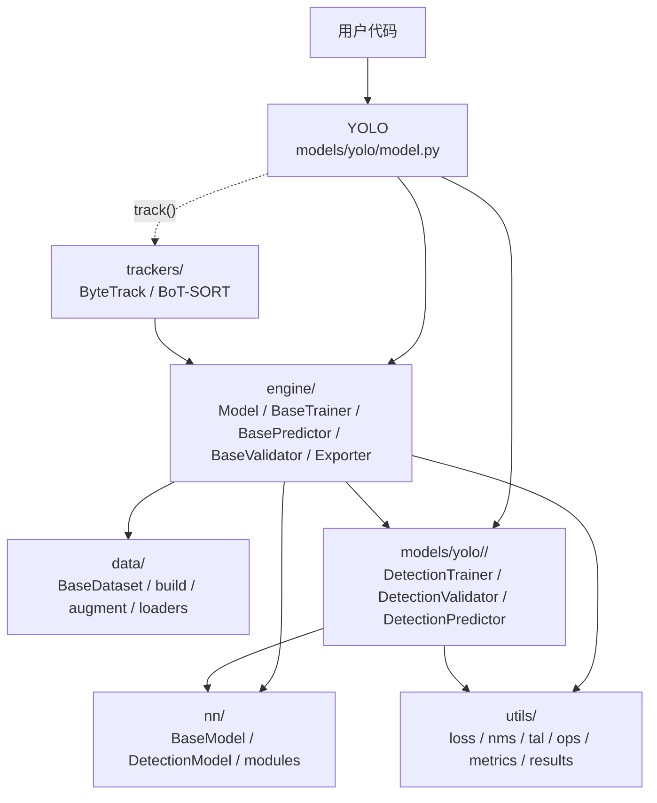
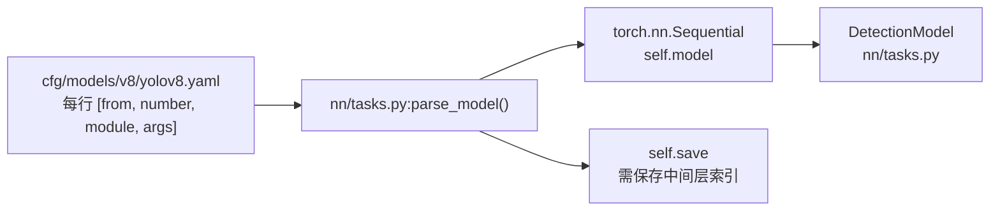
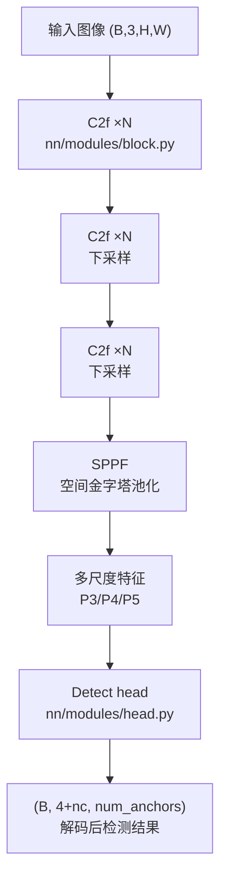
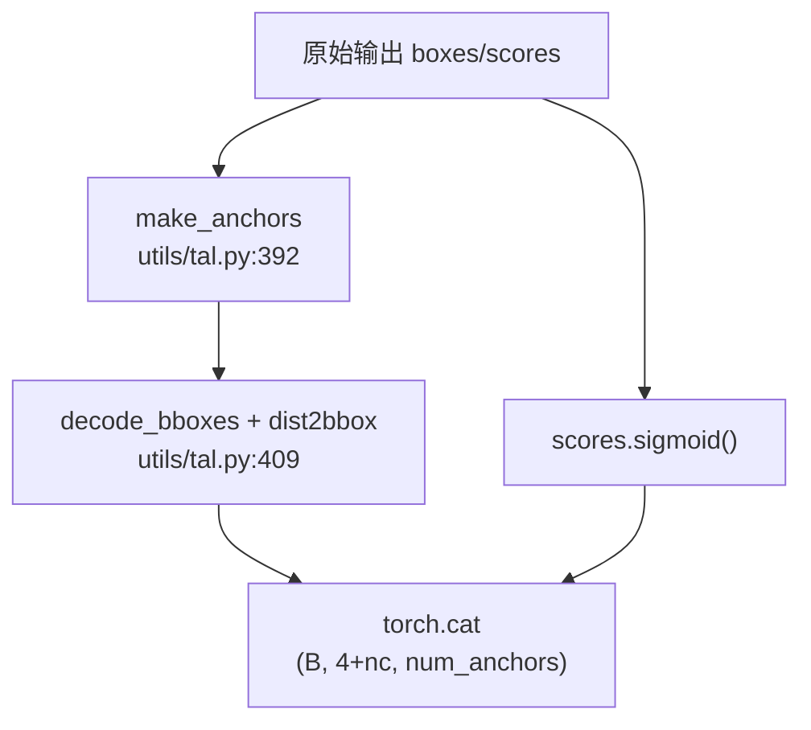
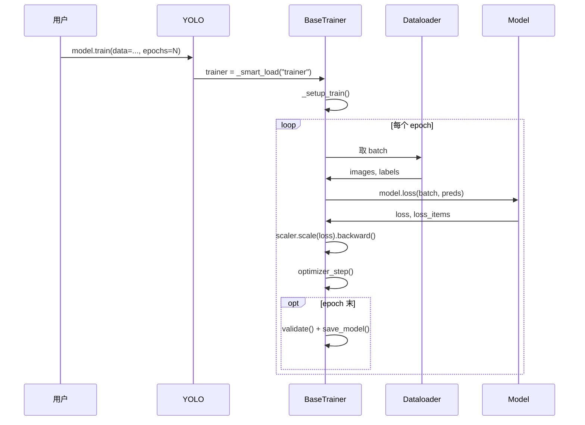
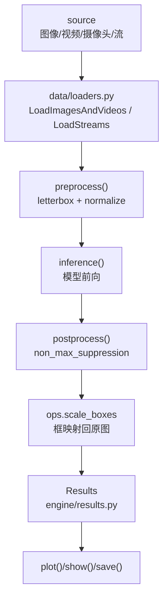
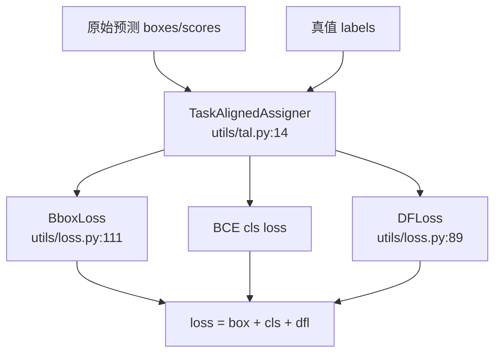

# Ultralytics YOLO 整体架构

> [!NOTE] 版本快照
> ultralytics `8.4.115` · torch `2.13.0` · Python `3.12` · 文档日期 `2026-08-02`。ultralytics 为 pip 安装包（非 git 仓库），无 commit/describe，以包版本号为准。

ultralytics 的核心是一条 `YOLO` 门面 + 三层引擎（`engine/` 的 Trainer/Predictor/Validator）+ 网络定义（`nn/`）+ 数据管线（`data/`）。用户几乎只接触 `YOLO` 类，具体任务（detect/segment/pose/...）通过 `task_map` 派发到对应的 Trainer/Validator/Predictor 子类。



这张图回答一个问题：**包内各目录的依赖关系**。`engine/` 是编排层，`nn/` 是被编排的模型，`models/yolo/<task>/` 把两者按任务组装起来，`utils/` 是共享工具。

源码入口：

- `models/yolo/model.py:YOLO`（门面）。
- `engine/model.py:Model`（基类方法 `train/val/predict/export/track`）。
- `nn/tasks.py:BaseModel` / `DetectionModel`（模型本体）。
- `engine/trainer.py:BaseTrainer`、`engine/predictor.py:BasePredictor`、`engine/validator.py:BaseValidator`。

## 模型装配：从 yaml 到网络

YOLO 模型不是手写网络代码，而是用 yaml 描述结构（`cfg/models/v8/yolov8.yaml`），由 `parse_model()` 解析成 `torch.nn.Sequential`。



源码入口：

- `nn/tasks.py:1929` `parse_model()`：解析 yaml 每行 `[from, number, module, args]`，处理输入通道推导和层间连接。
- `nn/tasks.py:DetectionModel.__init__`：调用 `parse_model()` 装配 `self.model` 和 `self.save`。
- `cfg/models/v8/yolov8.yaml`：结构描述（backbone `C2f` 堆叠、head `Detect`）。

> [!TIP]
> **想看懂模型结构，先看 yaml 再看代码**。yaml 里每一行对应 `parse_model()` 解析出的一个模块实例。改结构（加层、换模块）就是改 yaml，再配合 `nn/modules/` 里的实现。

## 主干与检测头：C2f、SPPF、Detect

YOLOv8 的 backbone 用 `C2f`（跨阶段 CSP 块）做特征提取，neck 末端用 `SPPF` 做空间金字塔池化，head 用 `Detect` 输出多尺度检测结果。



这张图回答一个问题：**一张图如何变成检测输出**。`C2f` 提取层级特征，`SPPF` 聚合多尺度感受野，`Detect` 在每个尺度上预测框与类别。

源码入口：

- `nn/modules/block.py:C2f`（`forward_split`，YOLOv8 主干块）。
- `nn/modules/block.py:SPPF`（空间金字塔池化）。
- `nn/modules/block.py:DFL`（Distribution Focal Loss 头，reg_max=16 的框分布积分）。
- `nn/modules/head.py:Detect.__init__` / `Detect._inference()` / `Detect._get_decode_boxes()`。
- `nn/tasks.py:DetectionModel`（组装 backbone+neck+head）。

### Detect 推理时如何解码框

训练时 `Detect.forward()` 返回原始 dict（`{"boxes", "scores", "feats"}`）；推理时走 `_inference()`：DFL 解码框坐标 + sigmoid 分类分数，拼成 `(B, 4+nc, num_anchors)`。



源码入口：

- `nn/modules/head.py:Detect._inference()`：`torch.cat((dbox, scores.sigmoid()), 1)`。
- `nn/modules/head.py:Detect._get_decode_boxes()`：`make_anchors` + `decode_bboxes`。
- `utils/tal.py:392` `make_anchors()`，`utils/tal.py:409` `dist2bbox()`。

## 训练主循环

`BaseTrainer._do_train()` 是训练的核心循环：逐 batch 前向、算 loss、反向、更新参数，周期验证并保存 checkpoint。



这张图回答一个问题：**一次训练调用内部发生了什么**。外层按 epoch、内层按 batch 迭代，loss 来自模型自身的 `loss()` 方法（委托给 criterion）。

源码入口：

- `engine/trainer.py:BaseTrainer.train()`：调 `_setup_train()` 再 `_do_train()`。
- `engine/trainer.py:_do_train()`（line 417）：主循环。
- `engine/trainer.py:setup_model()`、`build_optimizer()`、`get_dataloader()`、`build_dataset()`。
- `nn/tasks.py:BaseModel.loss(batch, preds)`：调 `self.criterion(preds, batch)`。
- `nn/tasks.py:DetectionModel.init_criterion()`：返回 `v8DetectionLoss`。

> [!IMPORTANT]
> **训练时 Detect 输出的是原始 dict，不是框**。`v8DetectionLoss` 消费的是 `{"boxes", "scores", "feats"}` 原始预测；NMS、解码、框坐标这些推理期操作在训练阶段完全不发生。理解这一层，才能看懂为什么"训练 loss 很高"和"推理结果为空"是两个层面的问题。

## 推理前处理 → 后处理

`BasePredictor` 把原始输入（图/视频/摄像头/流）变成 `Results`：`preprocess()`（letterbox + 归一化）→ `inference()` → `postprocess()`（NMS + 缩放框回原图）。



这张图回答一个问题：**一条输入到最终结果/可视化的完整路径**。关键点：模型在归一化、letterbox 后的张量上推理，输出框坐标要 `scale_boxes` 映射回原图尺寸才可信。

源码入口：

- `engine/predictor.py:BasePredictor.preprocess()` / `inference()` / `postprocess()`。
- `data/loaders.py:LoadImagesAndVideos`、`data/loaders.py:LoadStreams`。
- `models/yolo/detect/predict.py:DetectionPredictor.postprocess()`：调 `utils/nms.py:non_max_suppression`。
- `models/yolo/detect/predict.py:109` `DetectionPredictor.construct_result()`：`ops.scale_boxes` + 构造 `Results`。
- `engine/results.py:Results`（含 `Boxes.xyxy/.conf/.cls`）。

> [!WARNING]
> **letterbox 填充会让坐标失真**。`preprocess()` 用 `LetterBox` 缩放并填充到模型输入尺寸（如 640×640），网络输出的坐标是填充后画布坐标，必须经 `ops.scale_boxes` 映射回原图。跳过这一步会看到"框全偏了"的经典问题。

## 验证与指标

`BaseValidator` 循环验证集：`preprocess → inference → postprocess → update_metrics`，最终给出 mAP50 / mAP50-95 等指标。

源码入口：

- `engine/validator.py:BaseValidator.__call__`：验证主循环。
- `models/yolo/detect/val.py:DetectionValidator.update_metrics`：`_process_batch` 做预测/真值匹配。
- `utils/metrics.py:Metric`：mAP 计算。

## Loss 与标签分配

YOLOv8 的检测 loss 是 `v8DetectionLoss`，由 `TaskAlignedAssigner`（TAL）先做标签分配，再算 box/cls/dfl 三部分 loss。



这张图回答一个问题：**loss 由哪几部分构成、如何分配标签**。TAL 决定每个预测框匹配哪个真值框，然后三路 loss 加权求和。

源码入口：

- `utils/loss.py:337` `v8DetectionLoss`。
- `utils/loss.py:111` `BboxLoss`、`utils/loss.py:89` `DFLoss`、`utils/loss.py:22` `VarifocalLoss`。
- `utils/tal.py:14` `TaskAlignedAssigner`（topk=10, alpha=0.5, beta=6.0）。

## 任务族继承关系

detect/segment/pose/obb/classify/depth 共享一套基类，各自继承并覆写特定方法。

```text
engine/model.py:Model            → models/yolo/model.py:YOLO
engine/trainer.py:BaseTrainer    → models/yolo/detect/train.py:DetectionTrainer → Segment/Pose/OBB/...Trainer
engine/predictor.py:BasePredictor → models/yolo/detect/predict.py:DetectionPredictor → Pose/OBB Predictor
engine/validator.py:BaseValidator → models/yolo/detect/val.py:DetectionValidator → Pose/OBB Validator
nn/tasks.py:BaseModel            → DetectionModel → Segmentation/Pose/OBB/Depth Model
```

源码入口：

- `models/yolo/detect/__init__.py`：导出 `DetectionPredictor/DetectionTrainer/DetectionValidator`。
- `models/yolo/model.py:task_map`：任务 → 具体类映射。
