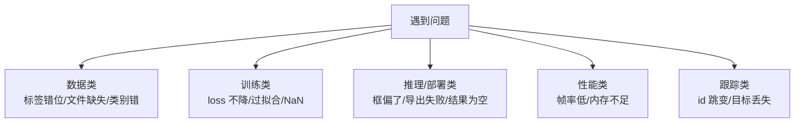

# YOLO 工程问题手册

> [!NOTE] 版本快照
> ultralytics `8.4.115` · torch `2.13.0` · Python `3.12` · 文档日期 `2026-08-02`。ultralytics 为 pip 安装包（非 git 仓库），无 commit/describe，以包版本号为准。

工程中遇到的 YOLO 问题大多集中在五类：**数据问题、训练问题、推理/部署问题、性能问题、跟踪问题**。下面的排查矩阵按"症状 → 先查什么 → 源码入口 → 处理"组织。



这张图回答一个问题：**问题先归类再排查**。五类问题各有典型的"先查字段/文件"。

## 数据问题排查

| 症状 | 先查什么 | 源码入口 | 处理 |
| --- | --- | --- | --- |
| 某图不参与训练 | 图与标签是否同名同路径 | `data/base.py:BaseDataset.get_labels()` | 检查 labels 目录文件 |
| 类别全错 | `data.yaml` 的 `names` 顺序是否与标签 id 对应 | `data/dataset.py:YOLODataset` | 核对 yaml names 索引 |
| 框全偏 | 标签坐标是否归一化 | `data/utils.py` | 检查 txt 是否除以图宽高 |
| 训练集/验证集混用 | yaml 的 train/val 路径 | `data/build.py:build_yolo_dataset()` | 拆分数据集 |
| 样本不均衡 | 各类别目标数差异大 | 自行统计 | 增样本或调 `cls` loss 权重 |

> [!WARNING]
> **数据问题最隐蔽，因为训练不报错**。标签文件存在但坐标错了、类别 id 错位，loss 照常下降、模型照常收敛，只是学出来的东西是错的。**改任何数据后先可视化标注**（`model.predict(show=True)` 或标注工具预览），再开训练。

## 训练问题排查

| 症状 | 先查什么 | 源码入口 | 处理 |
| --- | --- | --- | --- |
| loss 不降 | 学习率、batch、数据量 | `engine/trainer.py:build_optimizer()` | 检查 `lr0`，降 batch 或换预训练 |
| 过拟合（val 掉 train 升） | 数据量、增强强度、epoch 数 | `data/augment.py` | 增数据、加 Mosaic/MixUp、早停 |
| NaN loss | 学习率过大、数据有 NaN/Inf | `engine/trainer.py:_do_train()` | 降 `lr0`、清洗数据、开 AMP |
| 验证指标异常低 | 标签错位、类别错 | 同数据问题 | 先可视化标注 |
| 训练中途 OOM | batch 太大、imgsz 太大 | `cfg/default.yaml` | 降 batch、降 imgsz、开 AMP |

> [!TIP]
> **先用 `coco8.yaml` 冒烟**。训练不收敛前，先确认"代码/环境/数据管线"本身能跑通：用内置 8 图数据集跑一次完整训练，几十秒见分晓。环境问题排查完再上真实数据。

> [!IMPORTANT]
> **`loss * batch_size` 的含义**：`v8DetectionLoss.loss()` 返回 `loss * batch_size`，即**一个 batch 的总 loss**，不是单样本平均。对比不同 batch 的 loss 曲线时，先归一化到单样本再比，否则 batch 变了曲线就"跳"。

## 推理/部署问题排查

| 症状 | 先查什么 | 源码入口 | 处理 |
| --- | --- | --- | --- |
| 框偏了/位置不对 | 是否做了 `scale_boxes` | `models/yolo/detect/predict.py:construct_result()` | 确认框映射回原图 |
| 结果为空 | 置信度阈值 `conf`、`iou` | `utils/nms.py:non_max_suppression` | 降 `conf` 看原始输出 |
| 检测不准 | 模型是否匹配场景 | `what-yolo-can-do.md` | 微调/换更大模型 |
| 导出失败 | 是否满足运行时依赖 | `engine/exporter.py` | 查目标格式依赖 |
| 导出后精度掉 | INT8 量化 | `engine/exporter.py` | 用 `val()` 重新验证导出格式 |
| 加载慢/内存高 | 后端选择 | `nn/autobackend.py:AutoBackend` | 用合适后端、降分辨率 |

> [!TIP]
> **结果为空先别改代码，先降 `conf`**。`predict(conf=0.001, iou=0.9)` 看有没有"低置信度但有"的输出，能区分"模型没检测到"和"阈值过滤掉了"两种完全不同的情况。

## 性能排查

| 症状 | 先查什么 | 源码入口 | 处理 |
| --- | --- | --- | --- |
| 帧率低 | `Results.speed` 三段耗时 | `engine/results.py:Results.speed` | 定位是 preprocess/inference/postprocess 哪段慢 |
| 推理慢 | 模型大小、imgsz、后端 | `cfg/default.yaml` | 换小模型（n→s→m）、降 imgsz、换 CoreML |
| 内存不足 | batch、imgsz | `engine/predictor.py` | 降 batch/分辨率 |
| 多路并发慢 | 是否复用 model 实例 | 工程实践 | 复用已加载模型，避免重复加载 |

> [!NOTE]
> **`Results.speed` 是定位性能的第一手数据**。它分三段：`preprocess`（letterbox+归一化）、`inference`（模型前向）、`postprocess`（NMS+缩放）。哪段占比高针对性优化哪段。

## 跟踪问题排查

| 症状 | 先查什么 | 源码入口 | 处理 |
| --- | --- | --- | --- |
| id 频繁跳变 | 跟踪器配置、遮挡、帧率 | `trackers/` | 调 `cfg/trackers/bytetrack.yaml` 的 `conf`/`iou` |
| 目标丢失 | 检测漏检 | `utils/nms.py` | 先提升检测，跟踪依赖检测 |
| 轨迹不连续 | 帧率低、运动快 | `cfg/trackers/` | 提高处理帧率 |

> [!WARNING]
> **跟踪质量上限是检测质量**。跟踪器（ByteTrack 等）靠检测框做关联，检测漏检/错检会直接污染跟踪。先保证检测稳定，再调跟踪参数。

## 调试命令速查

```bash
# 单图推理，直观看到框
python -c "from ultralytics import YOLO; YOLO('yolov8n.pt').predict('bus.jpg', save=True)"

# 摄像头实时检测
python -c "from ultralytics import YOLO; YOLO('yolov8n.pt').predict(source=0, show=True)"

# 用 8 图数据集冒烟训练（验证环境）
yolo train data=coco8.yaml model=yolov8n.pt epochs=3

# 低阈值看"模型到底有没有检测到"
python -c "from ultralytics import YOLO; r=YOLO('yolov8n.pt').predict('bus.jpg', conf=0.001, iou=0.9)[0]; print(len(r.boxes))"

# 导出并看支持格式
python -c "from ultralytics import YOLO; YOLO('yolov8n.pt').export(format='coreml')"
```

> [!NOTE]
> 以上命令在 `~/ai-learning` 环境（`/Users/mac/work/github/ai-learning/.venv`）下运行，用 `.venv/bin/python` 或 `yolo` 命令。示例以 M4 Pro 上的 MPS 后端为默认。
