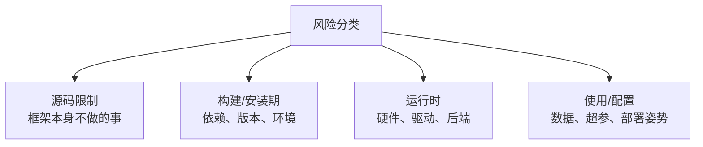
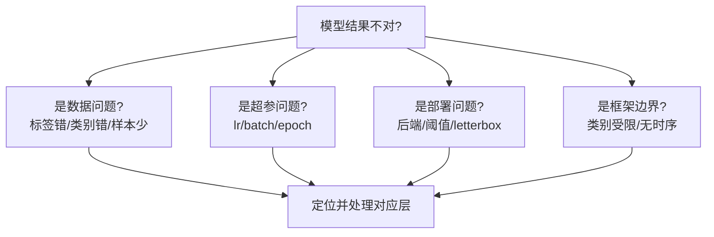

# YOLO 风险与缺陷清单

> [!NOTE] 版本快照
> ultralytics `8.4.115` · torch `2.13.0` · Python `3.12` · 文档日期 `2026-08-02`。ultralytics 为 pip 安装包（非 git 仓库），无 commit/describe，以包版本号为准。

按"源码限制 / 构建期选项 / 运行时依赖 / 使用配置"四类区分风险，避免把所有问题归咎于"模型不行"。

这张图回答一个问题：**一个 YOLO 问题的根源属于哪一层**。定位到层，才能选对处理手段。

## 源码限制（框架不做的事）

| 限制 | 说明 | 处理 |
| --- | --- | --- |
| 只认训练过的类别 | 预训练模型只能检测 COCO 80 类 | 自定义场景必须微调 |
| 单帧无时序 | 检测无"正在发生什么"概念 | 用 `track()` 或自建时序逻辑 |
| 小目标/遮挡弱 | 检测固有难点 | 换大模型、高分辨率输入、专用数据集 |
| 不做业务决策 | 不区分"报警/计数/切片" | 业务层消费 `Results` 自己实现 |

> [!IMPORTANT]
> **理解边界比修复 bug 更重要**。很多"YOLO 缺陷"其实是框架设计边界：它输出感知结果，不做智能决策。把边界当 bug 去"修复"是徒劳，正确做法是架构上把业务逻辑放在感知层之后。

## 构建/安装期风险

| 风险 | 症状 | 处理 |
| --- | --- | --- |
| Python 版本过旧 | 安装失败/import 报错 | 需 3.9+，推荐 3.11/3.12 |
| 依赖冲突 | torch/opencv 版本不兼容 | 用 venv 隔离，不污染系统 Python |
| MPS 不可用 | `mps` 后端报错 | 确认 `torch.backends.mps.is_available()`，退回 CPU |
| 包过大 | 安装慢/占用大 | 只装需要的，`pip install ultralytics` 自带 torch |

> [!NOTE]
> 你本机环境：Python 3.12.7 + PyTorch 2.13.0（MPS 可用）+ ultralytics 8.4.115，位于 `/Users/mac/work/github/ai-learning/.venv`。这是已验证可用的构建组合。

## 运行时依赖风险

| 风险 | 说明 | 排查 |
| --- | --- | --- |
| 导出需运行时依赖 | TensorRT 需 N 卡、TFLite 需 TF、Hailo 需板卡 | 先查 `export_formats` 再查环境 |
| 后端选择错误 | CUDA/MPS/CPU 混用 | 显式指定 `device` |
| 内存不足 | 统一内存/显存耗尽 | 降 batch、imgsz，开 AMP |
| 量化掉点 | INT8 精度损失 | 导出后重新 `val()` |

## 使用/配置风险

| 风险 | 症状 | 处理 |
| --- | --- | --- |
| 数据标签错位 | 模型学了错误的类别 | 训练前可视化标注 |
| 阈值不当 | 误检多（conf 低）或漏检多（conf 高） | 调 `conf`/`iou` |
| 预训练误用 | 把 COCO 模型当万能 | 明确能力边界，需要时微调 |
| 忽略 letterbox | 框坐标偏 | 用框架自带的 predict 管线 |
| 训练用错数据集 | 用 `coco8` 训练真实模型 | 冒烟用 coco8，正式用真实数据 |

> [!WARNING]
> **`coco8.yaml` 只用于冒烟，不能当真实训练数据**。它只有 8 张图，作用是验证管线通不通。用 8 张图训练出的模型没有任何实际价值——这是新手最常踩的坑之一。

## 风险决策树

先分类，再对症处理，是 YOLO 问题排查的通用路径。
