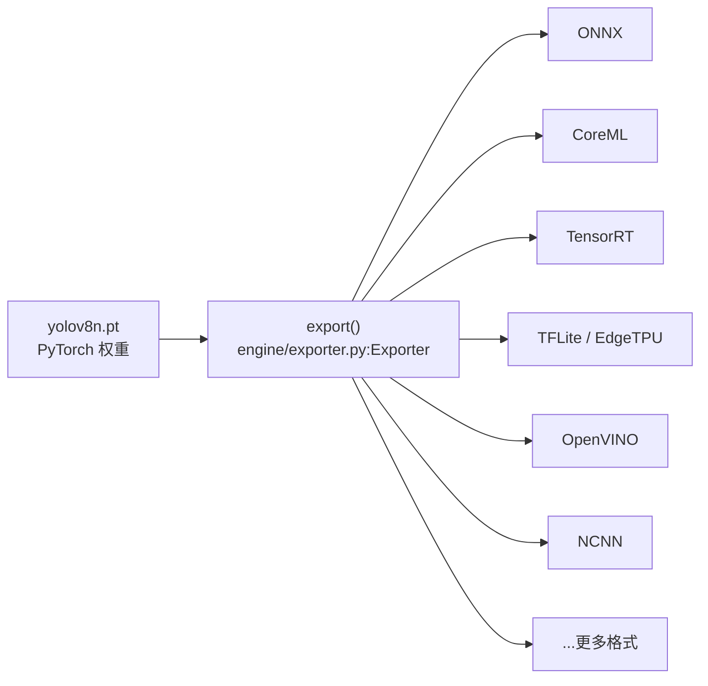
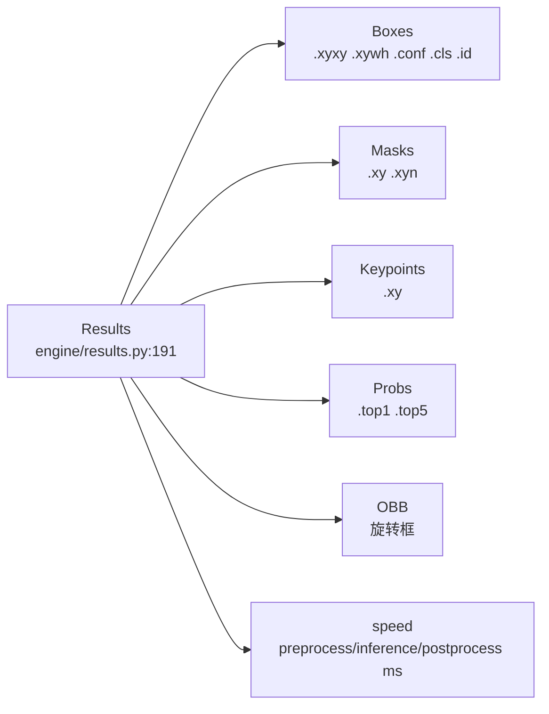
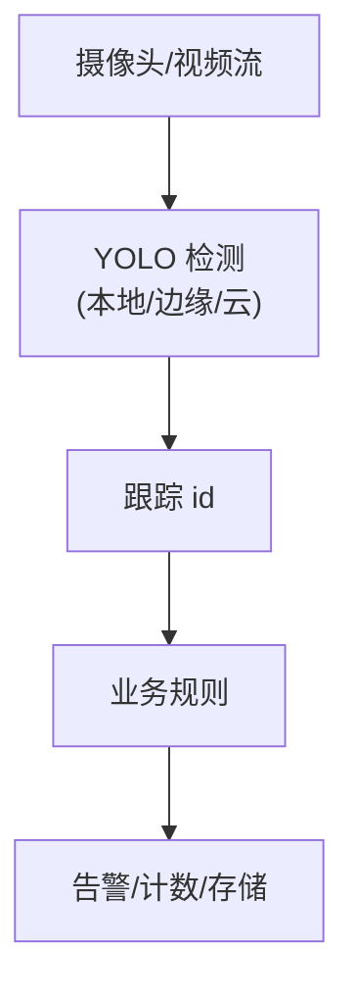

# YOLO 推理与部署

> [!NOTE] 版本快照
> ultralytics `8.4.115` · torch `2.13.0` · Python `3.12` · 文档日期 `2026-08-02`。ultralytics 为 pip 安装包（非 git 仓库），无 commit/describe，以包版本号为准。

推理统一走 `YOLO.predict()` / `model(source)`，返回 `list[Results]`。部署的核心是 `export()`——把 PyTorch 权重转成目标运行时的格式（ONNX / CoreML / TensorRT / TFLite ...）。

这张图回答一个问题：**一个 .pt 能导成哪些部署格式**。`Exporter` 负责转换，格式在 `export_formats` 里列出。

源码入口：

- `engine/model.py:Model.export()`：调 `Exporter(overrides=args)(model=self.model)`。
- `engine/exporter.py:Exporter`（含 `export_formats`）。
- `engine/exporter.py:Exporter.export_onnx()` / `export_coreml()` / `export_engine()`（TensorRT）等。

## 推理 API

| 用法 | 说明 | 源码入口 |
| --- | --- | --- |
| `model.predict(source)` | 单张图/列表推理，返回 `list[Results]` | `engine/model.py:Model.predict()` |
| `model(source)` | predict 的别名 | `engine/model.py:Model.__call__()` |
| `model.predict(stream=True)` | 视频/摄像头逐帧，返回迭代器 | `BasePredictor.stream_inference()` |
| `model.track()` | 检测 + 跨帧跟踪（ByteTrack/BoT-SORT） | `engine/model.py:Model.track()` |
| `model.embed()` | 输出特征向量（不做 NMS） | `engine/model.py:Model.embed()` |

`source` 支持：文件路径、URL、PIL 图像、numpy 数组、PyTorch tensor、摄像头索引 `0`、视频流。

## Results 对象

`Results` 是推理结果的结构化载体，含 `boxes`/`masks`/`keypoints`/`probs` 等组件。

这张图回答一个问题：**一次推理拿到什么**。`Results` 是容器，`Boxes` 等是访问器；`speed` 记录三段耗时，用于性能分析。

源码入口：

- `engine/results.py:Results`（line 191）。
- `engine/results.py:Boxes`（`.xyxy/.xywh/.conf/.cls/.id`）。
- `models/yolo/detect/predict.py:DetectionPredictor.construct_result()`：构造 `Results`。

> [!TIP]
> **单条检测框是 `(N, 6)` = `[x1,y1,x2,y2, conf, class_id]`**。这是 NMS 后输出到 `Results.boxes` 的原始形态，见 `models/yolo/detect/predict.py:construct_result`。写业务代码时常直接消费这个结构。

## 导出格式选择

选导出格式取决于**目标运行平台**：

| 部署目标 | 推荐格式 | 说明 |
| --- | --- | --- |
| 苹果生态（macOS/iOS） | CoreML | Apple 原生推理，M4 上走 ANE/GPU |
| NVIDIA GPU 服务器 | TensorRT | 最高吞吐，需 N 卡 |
| 跨平台/中间格式 | ONNX | 通用，可再转其他运行时 |
| 移动端/嵌入式（NPU） | TFLite / EdgeTPU / NCNN | 低算力设备 |
| Intel CPU/集成显卡 | OpenVINO | Intel 优化 |
| 嵌入式视觉板卡 | Hailo / RKNN / IMX / QNN | 特定芯片 |

> [!WARNING]
> **不是所有导出都保精度**。INT8 量化（EdgeTPU/Hailo 等）会掉点；TensorRT 的 FP16/INT8 也需要校准。导出后必须用 `val()` 对导出的格式重新验证指标，不能假设"格式变了精度不变"。

## 导出后推理

导出的模型仍可喂回 `YOLO()` 推理（如 `YOLO("model.onnx")`），`predict()` 会自动走对应后端（`nn/autobackend.py:AutoBackend` 做后端分派）。

源码入口：

- `nn/autobackend.py:AutoBackend`（多后端推理选择）。
- `engine/model.py:Model.predict()`（接受任意 `YOLO()` 能加载的模型路径）。

## 典型部署架构

YOLO 在部署中通常是**感知层**：消费像素、产出结构化目标（框 + 类别 + 置信度 + 可选 id），业务层基于这些目标做决策。
