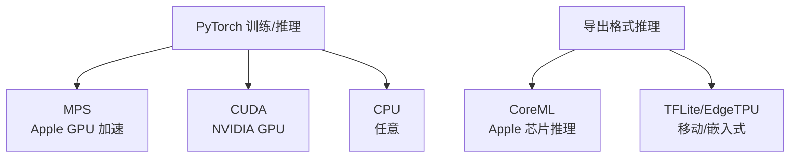

# YOLO 平台与运行环境矩阵

> [!NOTE] 版本快照
> ultralytics `8.4.115` · torch `2.13.0` · Python `3.12` · 文档日期 `2026-08-02`。ultralytics 为 pip 安装包（非 git 仓库），无 commit/describe，以包版本号为准。

ultralytics 跨平台、多后端。理解"源码支持 vs 构建可用 vs 运行时可用"三个层次，是部署前必做的判断。这里以你的 M4 Pro（macOS + Apple Silicon + 48GB 统一内存）为典型环境展开。

这张图回答一个问题：**同一份代码在不同设备上走什么后端**。训练/推理用 PyTorch 后端（MPS/CUDA/CPU），导出格式走各自专用后端。

## 训练后端对比

| 后端 | 适用设备 | 是否支持 | 特点 |
| --- | --- | --- | --- |
| MPS | Apple Silicon（M1~M4） | ✅ | 统一内存，中大规模模型可用；受内存带宽限制 |
| CUDA | NVIDIA GPU | ✅ | 生态最成熟、吞吐最高 |
| CPU | 任意 | ✅ | 可训练但极慢，只适合极小规模/验证 |
| ROCm | AMD GPU | ⚠ 有限 | 支持不完整 |

## M4 Pro 实战评估

你的机器（M4 Pro / 20 核 GPU / 48GB 统一内存）：

| 任务 | 可行性 | 说明 |
| --- | --- | --- |
| 推理（YOLOv8n） | ✅ 极快 | 实测单张 640×480 约 8~10ms |
| 推理（YOLOv8m/l） | ✅ 快 | 更大模型仍流畅，几十 ms |
| 实时摄像头检测 | ✅ | 配合 `stream=True`，帧率足够 |
| 训练小模型（n/s） | ✅ | 48GB 内存能跑，速度受 MPS 限制 |
| 训练大模型（l/x）+ 大数据 | ⚠ 慢 | 比中端 N 卡慢，适合学习/微调不适合大规模 |
| 微调（LoRA/全量小数据） | ✅ | 常用场景，完全够用 |

> [!TIP]
> **判断"能不能跑"看内存不看 GPU 数**。统一内存模型大小决定模型能否加载。48GB 可容纳 YOLOv8x + 较大 batch；内存不足时优先降 batch、降 `imgsz`，而不是换机器。

## 运行时硬件差异

| 差异点 | 说明 | 排查入口 |
| --- | --- | --- |
| 设备选择 | `device=0`（CUDA）/ `device=mps` / `device=cpu` | `cfg/default.yaml` `device` 字段 |
| 显存/内存不足 | 降 batch、imgsz，或开 AMP | `cfg/default.yaml` `amp` 字段 |
| 精度 | FP32/FP16/INT8 在不同后端表现不同 | `export()` 的 `half`/`int8` 参数 |
| 量化掉点 | INT8 后需重新 `val()` 验证 | `engine/exporter.py` |

## 构建 vs 运行时

- **源码支持**：代码里写了对某后端/格式的支持（`export_formats` 里有）。
- **运行时可用**：实际设备上是否装了对应驱动/依赖（如 NVIDIA 需要 CUDA Toolkit；TensorRT 需要 N 卡）。

> [!WARNING]
> **"支持"不等于"能用"**。`export_formats` 列出 ONNX/TensorRT/TFLite 等格式，但导出 TensorRT 需要 NVIDIA GPU、TFLite 需要 TF 依赖、Hailo 需要板卡工具链。导出失败先看是否满足运行时依赖，而不是改代码。

## Apple 生态部署

| 路径 | 说明 | 源码入口 |
| --- | --- | --- |
| PyTorch + MPS 推理 | 直接 `.pt` 推理，走 MPS | `nn/autobackend.py:AutoBackend` |
| CoreML 导出 | `export(format="coreml")`，走 ANE/GPU | `engine/exporter.py:Exporter.export_coreml()` |
| CoreML 推理 | `YOLO("model.mlpackage")` | `nn/autobackend.py` |

> [!NOTE]
> 在 Apple 设备上，**若追求推理速度优先 CoreML，若追求灵活/迭代速度优先 PyTorch+MPS**。M4 Pro 上 PyTorch MPS 推理已很快，很多场景无需导出 CoreML 就能满足实时性。
