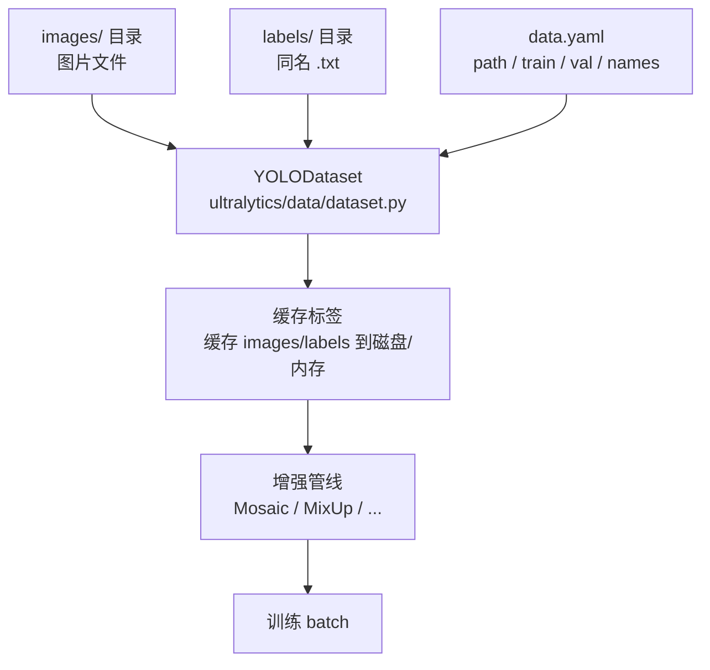
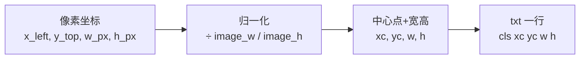

# YOLO 训练数据格式与标注管线

> [!NOTE] 版本快照
> ultralytics `8.4.115` · torch `2.13.0` · Python `3.12` · 文档日期 `2026-08-02`。ultralytics 为 pip 安装包（非 git 仓库），无 commit/describe，以包版本号为准。

YOLO 的数据格式是自描述的：**一个图像 + 一个同名 .txt 标签文件**，每行 `class_id x_center y_center width height`（归一化到 0~1）。数据集在 yaml 里声明类别与路径。



这张图回答一个问题：**标注数据如何变成训练输入**。`YOLODataset` 读取 images + 同名 labels + yaml，做标签缓存，再套增强管线。

源码入口：

- `data/dataset.py:YOLODataset`（YOLO 数据集类）。
- `data/base.py:BaseDataset.get_labels()` / `cache_images()`。
- `data/build.py:build_yolo_dataset()` / `build_dataloader()`。

## 数据目录布局

一个标准 YOLO 数据集：

```text
dataset_root/
├── data.yaml          # 数据集配置
├── images/
│   ├── train/
│   │   ├── img001.jpg
│   │   └── ...
│   └── val/
│       └── ...
└── labels/
    ├── train/
    │   ├── img001.txt   # 与 images 同名
    │   └── ...
    └── val/
        └── ...
```

`data.yaml` 格式：

```yaml
path: dataset_root        # 数据集根目录
train: images/train       # 相对 path 的训练图目录
val: images/val           # 相对 path 的验证图目录
names:
  0: person
  1: car
```

> [!IMPORTANT]
> **图像与标签文件必须同名、同相对路径**。`images/train/img001.jpg` 对应 `labels/train/img001.txt`。文件名不一致 = 该图没有标签，训练时被跳过或报错。这是数据错误里最常见的一种。

## 标签文件格式

每行一个目标：

```text
<class_id> <x_center> <y_center> <width> <height>
```

全部归一化到 `[0, 1]`：`x_center = bbox_left_px / image_width`，以此类推。坐标是**归一化的中心点 + 宽高**，不是左上角，也不是像素值。



源码入口：

- `data/base.py:BaseDataset.__getitem__`：返回含 `cls`、`bboxes` 的 dict。
- `data/utils.py`：标签加载与校验工具。

> [!WARNING]
> **归一化坐标与类别 id 错位是灾难**。`.txt` 第一列是类别 id，必须和 `data.yaml` 的 `names` 索引对应。换数据集没改 yaml，或标签类别写错，会导致模型学到的类别全是错的——loss 还正常下降，非常隐蔽。

## 增强管线

训练时 `data/augment.py` 的变换按顺序套在每张图上，Mosaic（拼接 4 图）与 MixUp 是提升泛化的关键。

| 增强 | 作用 | 源码入口 |
| --- | --- | --- |
| Mosaic | 4 张图拼成一张，丰富小目标/上下文 | `data/augment.py:Mosaic` |
| MixUp | 两张图按比例混合 | `data/augment.py:MixUp` |
| CutMix / CopyPaste | 目标区域裁剪粘贴 | `data/augment.py:CutMix` / `CopyPaste` |
| RandomPerspective | 透视/仿射变换 | `data/augment.py:RandomPerspective` |
| RandomHSV | 颜色抖动 | `data/augment.py:RandomHSV` |
| RandomFlip | 水平翻转 | `data/augment.py:RandomFlip` |
| LetterBox | 缩放 + 填充到模型尺寸 | `data/augment.py:LetterBox` |
| Format | 格式化为模型输入 | `data/augment.py:Format` |

> [!TIP]
> **增强在训练期生效、推理期只保留 LetterBox**。Mosaic/MixUp 这类强增强只用于训练（提升泛化），推理前处理只用 `LetterBox` 适配输入尺寸。两者不一致是正常的，别误以为模型在推理时"少做了步骤"。

## 常见数据集配置

`cfg/datasets/` 内置约 50 个数据集配置：`coco.yaml`、`coco8.yaml`（快速冒烟用，只有 8 张图）、`coco128.yaml`、`VOC.yaml`、`ImageNet.yaml` 等。

> [!NOTE]
> **`coco8.yaml` 是调试利器**。只有 8 张图，几十秒就能跑通一次完整训练，用来验证"环境/代码/数据管线"是否正常，再上真实数据。新手用它验证环境，比直接啃 COCO 高效得多。

源码入口：

- `cfg/datasets/coco8.yaml`（快速测试数据集）。
- `cfg/datasets/coco.yaml`（完整 COCO）。

## 标注工具与转换

- 标注工具：LabelImg、Label Studio、Roboflow 等可导出 YOLO 格式。
- 格式转换：COCO JSON / VOC XML → YOLO txt，用 `data/converter.py` 或第三方脚本。
- 数据集划分：`data/split.py` 可切分 train/val。

源码入口：

- `data/converter.py`、`data/split.py`、`data/annotator.py`。
