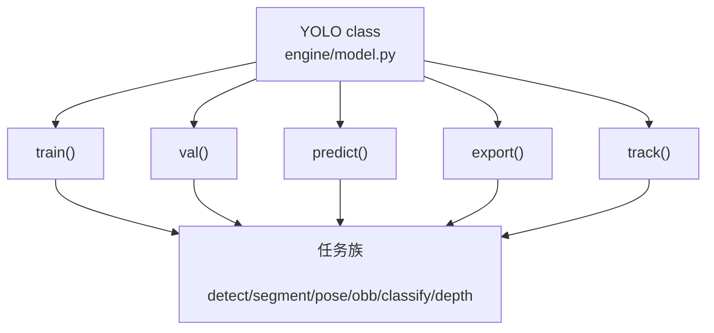
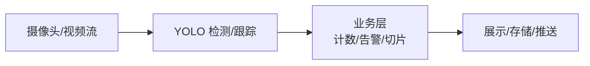

# YOLO 项目概览：能做什么

> [!NOTE] 版本快照
> ultralytics `8.4.115` · torch `2.13.0` · Python `3.12` · 文档日期 `2026-08-02`。ultralytics 为 pip 安装包（非 git 仓库），无 commit/describe，以包版本号为准。

Ultralytics YOLO 是一个基于 PyTorch 的计算机视觉框架，把"数据标注 → 训练 → 验证 → 推理 → 导出部署 → 跟踪"整条链路封装成一个 `YOLO` 类。它不只包含 YOLO 检测模型，而是一个覆盖多种视觉任务的产品化工具链。

这张图回答一个问题：**用户通过 `YOLO` 一个类能触达哪些能力**。`YOLO` 是门面，具体行为由 `task_map` 派发到 detect/segment/pose/obb/classify/depth 六个任务族。

源码入口：

- `models/yolo/model.py:YOLO`（用户入口类）。
- `models/yolo/model.py:task_map`（任务 → 具体类的映射）。
- `engine/model.py:Model`（基类，`train/val/predict/export/track` 定义处）。

## 能力边界

| 能力 | 说明 | 对应任务 | 源码入口 |
| --- | --- | --- | --- |
| 目标检测 | 输出每个目标的框 + 类别 + 置信度 | detect | `models/yolo/detect/` |
| 实例分割 | 输出像素级 mask + 框 | segment | `models/yolo/segment/` |
| 姿态估计 | 输出人体关键点 | pose | `models/yolo/pose/` |
| 旋转框检测 | 输出带角度的框（卫星/文档） | obb | `models/yolo/obb/` |
| 图像分类 | 单图输出类别概率 | classify | `models/yolo/classify/` |
| 深度估计 | 输出单目深度图 | depth | `models/yolo/depth/` |
| 目标跟踪 | 跨帧保持同一目标 id | track | `trackers/` |

> [!NOTE]
> **检测 ≠ 跟踪**。检测是逐帧独立的"在哪里、是什么"；跟踪是 `track()` 在检测基础上加 `trackers/`（ByteTrack、BoT-SORT 等）做跨帧关联，输出带 `id` 的框。这是常被混淆的一对概念。

## 能做什么

- **零训练跑通**：加载 `yolov8n.pt` 预训练权重即可对 COCO 80 类做检测（`YOLO("yolov8n.pt").predict("bus.jpg")`）。
- **定制训练**：用 COCO 格式数据集从零训练或微调，超参数走 `cfg/default.yaml`。
- **多格式导出**：PyTorch → ONNX / CoreML / TensorRT / TFLite / OpenVINO / NCNN / Hailo 等十余种，供移动端、边缘设备、服务器部署。
- **实时管线**：`predict(stream=True)` 对视频/摄像头逐帧推理；`track()` 加跟踪。
- **业务方案**：`solutions/` 提供计数、热力图、测速、越界告警等开箱方案。
- **多模态变体**：`YOLOWorld`（文本引导 zero-shot）、`YOLOE`（可提示视觉模型）、`SAM`/`FastSAM`（分割）、`RT-DETR`（端到端检测）。

## 不能做什么（重要边界）

- **不是通用智能**：输出严格绑定训练时定义的类别集合（COCO 80 类是默认，不是能力上限也是能力边界）。想识别自定义物体必须重新训练/微调。
- **不做时序推理**：单帧检测对"正在发生什么"无感知，只能靠 `track()` 或自建逻辑做帧间推断。
- **不负责业务决策**：检测出"人""车"后是报警还是计数，由业务层决定。
- **不保证小目标/遮挡性能**：小目标、密集遮挡、极端角度仍是检测的固有难点，不是改配置能解决的。
- **训练≠部署**：训练好的 `.pt` 是 PyTorch 权重，要上移动端/边缘设备必须走 `export()`。
- **不是零成本**：训练需要 GPU/内存资源；M4 Pro 这类统一内存机器受内存带宽限制，大规模训练效率低于 N 卡。

> [!WARNING]
> **预训练模型 ≠ 你的场景可用模型**。`yolov8n.pt` 只认识 COCO 80 类。如果你要识别"自家产线上的螺丝"，必须收集数据、标注、微调——这一步无法跳过，是 YOLO 项目最容易被低估的工程量。

## 真实产品中的位置

YOLO 负责从原始像素中提取"语义信息"（有目标、在哪、是什么），业务层消费这个结构化结果。这是它在一套真实系统中的典型位置——**它不是终点，是感知前端**。
